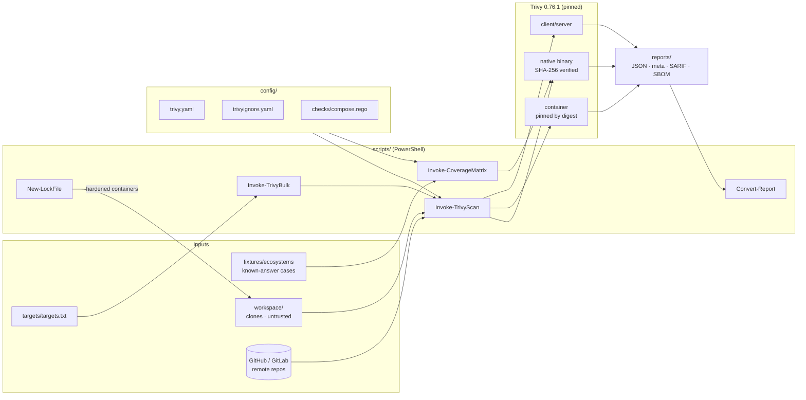
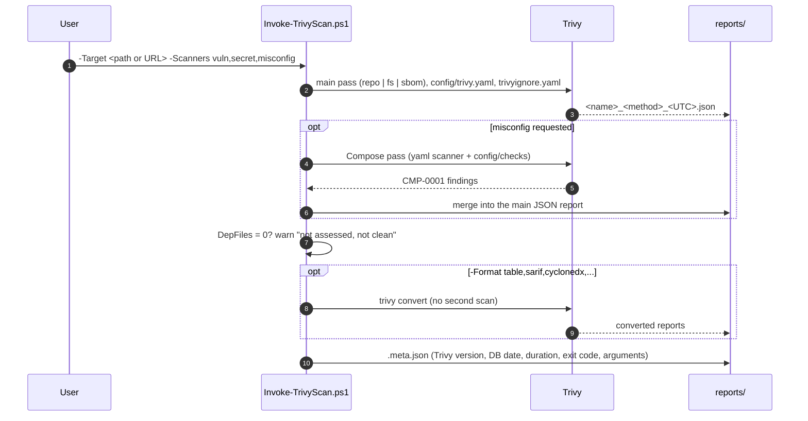
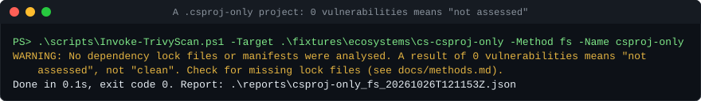
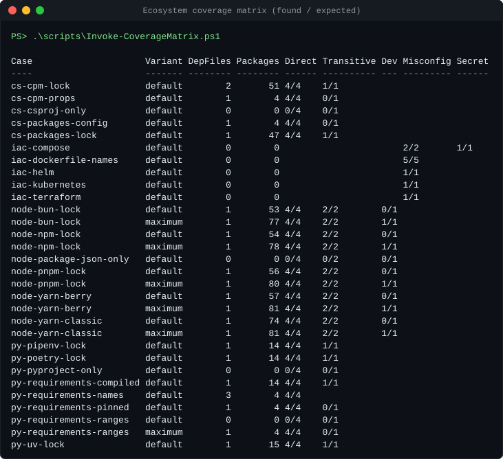
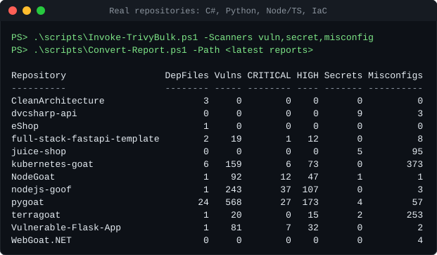
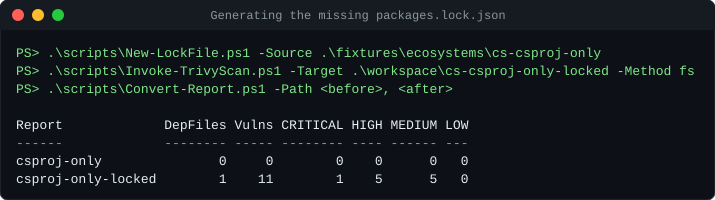
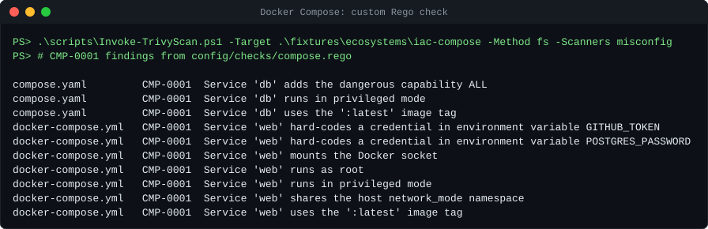

# Trivy blind spots

**How much does Trivy really see?** A reproducible lab for evaluating [Trivy](https://trivy.dev) as a tool for **vulnerability
assessment of whole source repositories**. Repositories can be given as a local Git
folder, a remote URL, a filesystem path or an SBOM. The lab measures what Trivy finds,
what it silently misses, and how to close the gaps.

[](https://github.com/stefanicla/trivy-blind-spots/actions/workflows/ci.yml)

<!-- Tooling -->


[](LICENSE)

<!-- Ecosystems covered -->


> [!IMPORTANT]
> **Key findings**
> - Without a committed **lock file**, Trivy reports *0 vulnerabilities* with no warning.
>   For C#, the default `.csproj` `PackageReference` style is **not read at all**. Two
>   deliberately vulnerable C# apps came back "clean"; with generated lock files they
>   show 8 and 32 vulnerabilities.
> - In C#, **most of the risk is transitive** (33 of 40 findings), which is invisible
>   without `packages.lock.json`.
> - **Docker Compose has no built-in checks**; this lab adds a custom Rego check.
> - Two Trivy pitfalls are worked around here: pip files named anything other than
>   `requirements.txt` are ignored, and enabling the generic `yaml` scanner with custom
>   checks silently drops all Kubernetes findings.

## Contents

- [What the lab does](#what-the-lab-does)
- [Architecture](#architecture)
- [Architectural choices](#architectural-choices)
- [Prerequisites](#prerequisites)
- [Running the lab, step by step](#running-the-lab-step-by-step)
- [Results at a glance](#results-at-a-glance)
- [Repository layout](#repository-layout)
- [Security considerations](#security-considerations)
- [Limitations](#limitations)
- [Further documentation](#further-documentation)
- [Licence](#licence)

## What the lab does

| | |
|---|---|
| **Goal** | Decide whether Trivy is fit for assessing whole repositories, and how to use it |
| **Ingestion methods** | Local Git folder, remote URL (branch / tag / commit), filesystem, manual clone, SBOM round-trip, container, client/server, bulk (targets file or GitHub organisation), offline |
| **Scanners** | Vulnerabilities, secrets, misconfigurations (IaC), licences |
| **In scope** | C#/.NET, Python, JavaScript/TypeScript (Node), Terraform, Dockerfile, Docker Compose, Kubernetes/Helm |
| **Out of scope** | Java, PHP (tested early on, dropped) |
| **Evidence** | Known-answer fixtures with expected findings, 12 real public repositories, 18 documented experiments |

## Architecture



What a single `Invoke-TrivyScan.ps1` run does:



## Architectural choices

| Choice | Why |
|---|---|
| **PowerShell scripts only** | The lab runs on Windows hosts. PowerShell 7 also runs on Linux, which the CI lint job relies on |
| **Pinned Trivy binary with a hard-coded SHA-256**, not a package manager | Trivy suffered a supply-chain compromise in March 2026 ([CVE-2026-33634](https://github.com/aquasecurity/trivy/security/advisories/GHSA-69fq-xp46-6x23)): malicious v0.69.4 binary, malicious v0.69.5/v0.69.6 images, hijacked GitHub Action tags. An exact version plus a checksum committed in this repository cannot be silently swapped |
| **Every container image pinned by digest; every Action pinned by commit SHA** | Same reason; tags are mutable. Dependabot proposes Action updates |
| **JSON is the only scan output**; other formats come from `trivy convert` | One scan per target. SARIF, CycloneDX, SPDX and table are derived losslessly, so results are consistent across formats |
| **`.meta.json` sidecar** per report | Results change as the vulnerability DB changes. The Trivy version, DB date, duration, exit code and full argument list make runs comparable over time |
| **Telemetry and version check disabled** (`config/trivy.yaml`) | Trivy sends usage telemetry by default; a security lab should not phone home |
| **`DepFiles` guard** (warning + column) | Trivy returns the same "0 vulnerabilities" for a clean project and for one it could not analyse. The guard makes "not assessed" visible |
| **Separate Docker Compose pass** | Trivy has no Compose checks; the custom Rego check needs the generic `yaml` scanner. Combined with custom checks in one pass, that scanner reclassifies Kubernetes manifests as plain YAML and drops all Kubernetes findings. Two passes, merged into one report, avoid this |
| **`file-patterns` for pip** | Trivy only reads files named exactly `requirements.txt`; `requirements-dev.txt`, `requirements/base.txt`, … were silently ignored |
| **Committed known-answer fixtures** (`expected.txt` per case) | Coverage claims are tested, not assumed. Lock files are produced by the real package managers. Fake secrets are generated at runtime, so nothing token-shaped is committed |
| **`workspace/` treated as untrusted** | Scripts live outside cloned code and take paths as arguments; nothing is executed from inside a target |
| **Hardened throw-away containers for lock-file generation** | Package managers resolve third-party manifests. Containers have no capabilities, `no-new-privileges`, resource limits, only the copy mounted, and no credentials. npm scripts and Python source builds are disabled. `dotnet restore` still evaluates MSBuild, so project files are reviewed first |
| **Repository-local cache** (`cache/`) | Reproducible, easy to wipe, and shareable with the container (`cache/docker`) |

## Prerequisites

| Tool | Version used | Needed for |
|---|---|---|
| Windows + PowerShell | 7.4+ | Everything |
| Git | 2.4x+ | Local targets, manual clones, fixtures |
| Docker Desktop | 29.x | `docker-*` methods, lock-file generation, fixture regeneration, README images |
| GitHub CLI (`gh`) | any | Optional: `Invoke-TrivyBulk.ps1 -GitHubOrg` |

Trivy itself is downloaded by the lab; do not install it separately.

## Running the lab, step by step

All commands run from the repository root in PowerShell 7.

### 1. Install the pinned Trivy

```powershell
.\scripts\Install-Trivy.ps1
```

This downloads Trivy 0.76.1 into `tools\`, verifies its SHA-256 (it aborts on a
mismatch) and prints `Version: 0.76.1`.

### 2. Run the known-answer test

```powershell
.\scripts\Test-KnownAnswer.ps1
```

This builds `workspace\fixture-local`, a Git repository with:
- old Python and npm packages;
- a live fake token;
- a fake AWS key that exists only in Git history;
- a bad Dockerfile and a bad Terraform file.

It then scans the fixture and prints a PASS/FAIL line per seeded finding. The last check
confirms the documented gap: secrets that exist only in history are **not** reported.

### 3. Scan a repository

```powershell
# Local Git folder
.\scripts\Invoke-TrivyScan.ps1 -Target C:\src\my-repo -Scanners vuln,secret,misconfig

# Remote URL, optionally at a branch, tag or commit
.\scripts\Invoke-TrivyScan.ps1 -Target https://github.com/OWASP/NodeGoat -Scanners vuln,secret,misconfig
.\scripts\Invoke-TrivyScan.ps1 -Target https://github.com/OWASP/NodeGoat -Tag v1.3

# Any folder, including uncommitted changes
.\scripts\Invoke-TrivyScan.ps1 -Target C:\src\my-repo -Method fs
```

Always use `-Scanners vuln,secret,misconfig` for a full assessment. Misconfiguration
scanning is off by default, and it is what covers Dockerfile, Compose, Kubernetes, Helm
and Terraform.

For private repositories, set `GITHUB_TOKEN` or `GITLAB_TOKEN` in the environment.
Tokens are never put on the command line or into reports.

If Trivy found no dependency file to analyse, you get a warning:



### 4. Read the results

```powershell
.\scripts\Convert-Report.ps1 -Path .\reports -Top 5      # objects; add -Markdown for a table
.\scripts\Invoke-TrivyScan.ps1 -Target ... -Format table,sarif,cyclonedx,spdx-json
```

| Column | Meaning |
|---|---|
| `DepFiles` | Dependency files Trivy analysed. **0 means vulnerabilities were not assessed** |
| `Vulns`, `UniqueCVEs`, `CRITICAL` … `UNKNOWN` | Vulnerability findings |
| `Secrets`, `Misconfigs`, `Licences` | Other finding classes |
| `Suppressed` | Findings hidden by `config/trivyignore.yaml` (with `--show-suppressed`) |
| `DbUpdatedAt` | Vulnerability-DB date, from the `.meta.json` sidecar |

### 5. Measure ecosystem coverage

```powershell
.\scripts\Invoke-CoverageMatrix.ps1
```

This scans every case in `fixtures/ecosystems/` and compares the findings with each
case's `expected.txt`. Each case runs with the default settings and again with
`--include-dev-deps --detection-priority comprehensive`:



### 6. Scan many repositories

```powershell
.\scripts\Invoke-TrivyBulk.ps1 -Scanners vuln,secret,misconfig            # targets/targets.txt
.\scripts\Invoke-TrivyBulk.ps1 -GitHubOrg my-org -Limit 50 -Scanners vuln,secret,misconfig
```

Each line of `targets/targets.txt` is `<URL or path> [method] [extra Trivy arguments]`.
Failures are logged, and the batch continues.



### 7. Repositories without lock files

```powershell
.\scripts\New-LockFile.ps1 -Source .\workspace\some-repo          # -> .\workspace\some-repo-locked
.\scripts\Invoke-TrivyScan.ps1 -Target .\workspace\some-repo-locked -Method fs
```

The script generates `packages.lock.json` (C#), `uv.lock` or compiled requirements
(Python) and `package-lock.json` (Node) on a copy, in hardened containers.

> [!WARNING]
> `dotnet restore` evaluates MSBuild project files, which can execute code. Review
> `*.csproj`, `Directory.Build.*` and `nuget.config` first, and only run it on code you
> are entitled to assess. Resolved versions are today's, which may not be what is
> deployed.



### 8. Docker Compose and other IaC

Misconfiguration checks for Dockerfile, Kubernetes, Helm and Terraform are built in.
For Docker Compose, the scan script runs the custom check `config/checks/compose.rego`
automatically:



### 9. Other ingestion methods

```powershell
# Container (no host install), image pinned by digest
.\scripts\Invoke-TrivyScan.ps1 -Target C:\src\my-repo -Method docker-fs
.\scripts\Invoke-TrivyScan.ps1 -Target https://github.com/org/repo -Method docker-repo

# SBOM round-trip: inventory now, re-assess later without the source
.\tools\trivy.exe fs --format cyclonedx --output repo.cdx.json C:\src\my-repo
.\scripts\Invoke-TrivyScan.ps1 -Target .\repo.cdx.json -Method sbom

# Client/server: one DB, many thin clients
.\tools\trivy.exe server --listen localhost:4954 --token <secret> --cache-dir .\cache\server
.\scripts\Invoke-TrivyScan.ps1 -Target https://github.com/org/repo -Server http://localhost:4954 -ExtraArgs '--token','<secret>'

# Offline: pre-fetch the DB, then scan without network
.\tools\trivy.exe fs --download-db-only --cache-dir .\cache
.\scripts\Invoke-TrivyScan.ps1 -Target C:\src\my-repo -Method fs -Offline
```

### 10. Suppress accepted findings

Add time-boxed entries to `config/trivyignore.yaml`. Each entry needs a `statement`
(the reason) and an `expired_at` date. Expired entries stop applying automatically, and
`--show-suppressed` keeps an audit trail.

### 11. Regenerate fixtures and images (optional)

```powershell
.\scripts\New-EcosystemFixtures.ps1   # re-resolves lock files with today's versions (Docker)
.\scripts\Update-ReadmeImages.ps1     # re-renders docs/images/*.svg from real runs (Docker)
```

## Results at a glance

| Ecosystem | Full coverage (direct + transitive) | Direct only | **Not read: silent 0** |
|---|---|---|---|
| C# / .NET | `packages.lock.json` | `Directory.Packages.props`, `packages.config` | `.csproj` `PackageReference` |
| Python | `uv.lock`, `poetry.lock`, `Pipfile.lock`, fully pinned requirements | `requirements*.txt` with `==` pins | `pyproject.toml` alone, requirements with ranges |
| JS / TS | npm, yarn (v1 and Berry), pnpm, bun lock files | — | `package.json` alone |
| IaC | Dockerfile (any naming), Kubernetes, Helm, Terraform | — | Docker Compose (custom check provided) |

All ingestion methods produced identical findings on the same commit. Full results, the
real-repository table, 18 experiments and the recommendations are in
[docs/results.md](docs/results.md).

## Repository layout

```
.github/        CI workflow (lint, gitleaks, Trivy self-scan, known-answer test), Dependabot
config/         trivy.yaml, trivyignore.yaml, checks/compose.rego
docs/           methods.md, test-plan.md, results.md, images/
fixtures/       ecosystems/<case>/ - known-answer cases with expected.txt
scripts/        Install-Trivy, Invoke-TrivyScan, Invoke-TrivyBulk, Convert-Report,
                Invoke-CoverageMatrix, New-LockFile, New-Fixture, New-EcosystemFixtures,
                Test-KnownAnswer, Update-ReadmeImages, New-TerminalSvg
targets/        targets.txt - repositories for bulk scans
tools/          pinned trivy.exe                                   (git-ignored)
workspace/      clones and generated targets - untrusted           (git-ignored)
reports/        <name>_<method>_<UTC>.json + .meta.json + formats  (git-ignored)
cache/          Trivy DB and scan cache                            (git-ignored)
```

## Security considerations

- **Intentionally vulnerable test data.** `fixtures/` pins vulnerable package versions
  and contains misconfigured IaC on purpose. GitHub's Dependabot alerts will flag those
  lock files; they are test data, not dependencies of this project. Fake secrets are
  generated at runtime and never committed.
- **Untrusted targets.** Never run build tools, package managers or scripts from inside
  `workspace/`, except through `New-LockFile.ps1`'s hardened containers, as described
  above.
- **Upgrading Trivy.** Read the release notes, then update the version **and** SHA-256 in
  `Install-Trivy.ps1` and the image digest in `Invoke-TrivyScan.ps1`. Then run
  `Test-KnownAnswer.ps1`. Never install `latest`, and never v0.69.4 – v0.69.6.
- Report vulnerabilities in this project as described in [SECURITY.md](SECURITY.md).

## Limitations

- **Lock files are required** for real coverage (see above); `New-LockFile.ps1` is only a
  stop-gap.
- **Secrets in Git history** are not scanned by Trivy. Use gitleaks; a pinned command
  is in [docs/results.md](docs/results.md).
- **Plain-text passwords** without a recognisable token format are not secret findings
  (the Compose check flags credential-like variables).
- **OS packages** of base images are not assessed by `repo`/`fs`; build the image and
  use `trivy image`.
- **No reachability analysis:** every vulnerable dependency is reported, whether used or
  not. Triage with VEX or `trivyignore.yaml`.

## Further documentation

| Document | Content |
|---|---|
| [docs/methods.md](docs/methods.md) | Every ingestion method, with trade-offs, and what Trivy reads per ecosystem |
| [docs/test-plan.md](docs/test-plan.md) | Targets and the experiment matrix (E00–E18) |
| [docs/results.md](docs/results.md) | All results, pitfalls and recommendations |
| [SECURITY.md](SECURITY.md) | Reporting vulnerabilities, scope, pinning policy |
| [CHANGELOG.md](CHANGELOG.md) | Release history |

## Licence

[MIT](LICENSE) © 2026 Claudio Stefani
